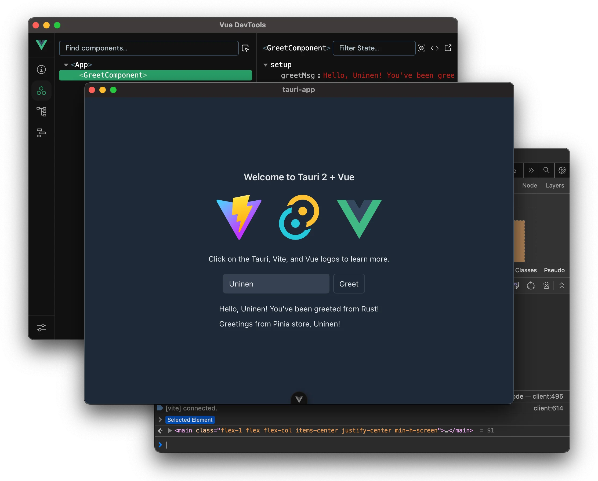

# Tauri + Vue + Vite Template



A production-ready template to build fast, secure desktop apps with Tauri and Vue.

## 接入 agent 状态：把 hook 交给你的 agent 去配

UFO 的状态灯靠 agent 平台自己的 hook 把事件喂给它 —— 本质是往 `~/.claude/settings.json`（或 `~/.qoder/settings.json`、`~/.codex/hooks.json`）的 `hooks` 块里加一批命令。**推荐让 agent 替你写这份配置**，而不是手改 JSON：

1. 先装 UFO 的安装包（MSI 或 setup.exe）。安装器会把安装目录写进**当前用户**的 PATH，裸命令 `ufo` 才存在；App 运行期不碰环境变量，卸载时那一条由安装器自己摘掉。
2. ⚠️ **重启你的 agent 宿主进程**（只新开一个终端不管用）。hook 由 agent 进程派生，环境块在进程启动那一刻复制一份，装完不重启就永远看不到 `ufo`。
3. 把下面这段丢给要接入的那个 agent（`claude` 换成你那一家即可）：

```text
帮我把 UFO 的状态灯 hook 接进你的配置，要求：
1. 先读本仓库的 reference/doc/rule/agent-status-hooks.md 里你这一家的章节，事件清单与命令形状以它为准。
2. 只动你自己那份配置文件的 hooks 块：合并而不是覆盖，我已有的 hook 一条都不许丢、也不许改。
3. 命令用裸名字 `ufo --status-hook --provider claude`，不要写绝对路径 —— 安装器已经把 UFO 放进 PATH 了（只有跑源码开发时才用绝对路径，那份文档的「安装前提」写了原因）。
4. Codex 只配 PermissionRequest 这一个事件，其余 UFO 走 rollout，多配等于白花。
5. 写完把文件回读一遍，确认 JSON 仍可解析，然后列出你新增或改动的事件名。
```

4. 验一下：新开一轮会话看悬浮窗是否出灯。不亮的排查顺序（`where ufo`、手动喂一条假 payload 看退出码、转灯日志与 inbox）都在那份文档的「状态目录与排查」一节。

细则只在那份文档里，本 README 不复制事件清单 —— 抄一遍就多一处会漂的地方。

## Features

- **Vue 3 + TypeScript** - Type-safe frontend with devtools
- **Tailwind 4** - CSS preconfigured for native app development
- **Vite** - Fast builds with [AutoImport](https://github.com/antfu/unplugin-auto-import) for cleaner code
- **Vitest** - Unit testing ready to go
- **CI/CD included** - GitHub Actions for automated testing, builds, and releases
- **VS Code ready** - Debugging configs and recommended extensions

## Quick Start

1. Install [Tauri prerequisites](https://tauri.app/start/prerequisites/)
2. Clone and install dependencies:

```sh
pnpm i
```

1. Run the development server (starts both the backend and frontend dev servers and opens the devtools):

```sh
pnpm tauri dev
```

## Project Structure and Usage

A Tauri app has [two processes](https://tauri.app/concept/process-model/):

- **Core Process** (`backend`, or _main_ process in Electron terminology)
- **WebView process** (`frontend`, _renderer_ in Electron)

### Frontend (TS, PnPM)

Frontend code lives in `src/`. See `package.json` for all available commands.

**Testing:**

```sh
pnpm test
```

### Backend (Rust, Cargo)

Backend code lives in `src-tauri/`.

**Finding outdated dependencies** (requires [cargo-outdated](https://github.com/kbknapp/cargo-outdated)):

```sh
cd src-tauri && cargo outdated
```

**Upgrading dependencies** (requires [cargo-edit](https://github.com/killercup/cargo-edit)):

```sh
cd src-tauri && cargo upgrade
```

### Debugging

- The `dev` command has by default `RUST_BACKTRACE=1` set which makes Rust output full backtraces to the console. (Remove it from the `package.json` command if you don't want it).
- Webview devtools are opt-in per window (debug builds only). Set `UFO_DEVTOOLS=true` for all three windows, or `UFO_DEVTOOLS=floating,tooltip` to pick some — either in your shell or in the repo `.env` (rebuild needed for the latter). Default is none.
- If you use VS Code, you can debug Rust code with the included `Debug Tauri` config.

### Building and releasing

#### Building

The project has GitHub Actions set up which will automatically test and build your app with every push and PR. To build manually run:

```sh
pnpm tauri build
```

#### Releasing a new version

1. Bump version number by running `pnpm bump [x.y.z]`
2. Run `pnpm check` to update `Cargo.lock`
3. Tag the commit you want to release with `vX.Y.Z`
4. Edit the release notes and push (also tags!)
5. Github workflow will automatically build a new draft release for this version. Publish when ready 🎉

## Follow Along

- Follow [@uninen on X](https://x.com/uninen) or [uninen.net on Bluesky](https://bsky.app/profile/uninen.net)
- Read my learnings around Tauri / Vue / TypeScript and other Web dev topics from my [Today I Learned blog](https://til.unessa.net/)
- If you speak Finnish, check out [Koneoppiblogi](https://koneoppiblogi.uninen.net)

## Contributing

Contributions are welcome! Please [be nice](./CODE_OF_CONDUCT.md) when interacting with others.
