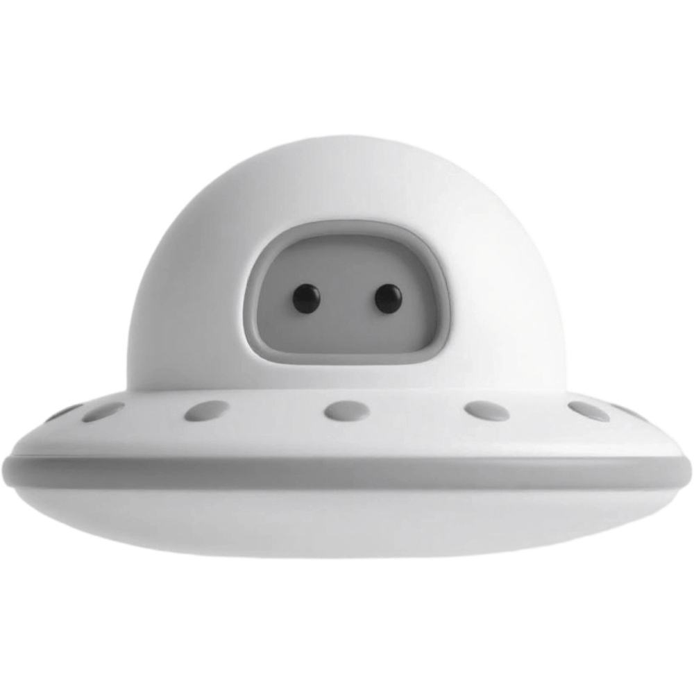

<div align="center">



# UFO

**一块可拼装的桌面悬浮窗：agent 在干活、在等你、还是出了错，抬眼就知道。**

[](./LICENSE)
[](#安装)
[](https://tauri.app)
[](https://vuejs.org)

</div>

你让 Claude Code / Codex / Qoder 去办一件事，然后切去别的地方干活。UFO 把它现在的状态亮在屏幕角上，
不用你回去刷页面猜。

## 目录

- [灯怎么读](#灯怎么读)
- [界面上有什么](#界面上有什么)
- [支持的工具](#支持的工具)
- [安装](#安装)
- [组件包（插件）](#组件包插件)
- [数据与隐私](#数据与隐私)
- [开发](#开发)
- [发版](#发版)
- [文档地图](#文档地图)
- [已知代价](#已知代价)

## 灯怎么读

| 灯 | 意思 |
| --- | --- |
| 🟢 常亮 | 正在执行（后台子代理还在跑也算） |
| 🟡 常亮 | **等你动手**：要授权、在回答问题、或者空闲等输入 |
| 🔴 常亮 | 出错、失败或被取消 |
| 🟢 闪一下 → 🟡 | 这一轮跑完了，对话没结束 |
| 🟢 闪一下 → 消失 | 对话结束了 |

一盏灯 = 一个会话（按 `平台:会话 id` 去重），最多同时亮 8 盏；多出来的折成一个 `+N` 环格，悬停它能把被折起来的
每一盏都列出来。灯色判定全在后端状态机里，前端只负责画。

## 界面上有什么

- **悬浮窗**是容器，里面的组件同级共享同一块窗。它随贴边状态换形态：没贴边是方形，贴上/下边变横条，
  贴左/右边变竖条，四角则按格竖排。默认一格 45px，可在设置里调。
- **悬停信息卡**给这一盏灯的：走的是哪个 endpoint（本地代理会副标注）、本轮已用多少 token、你在流程脚本里
  自定义的拓展字段，以及你那句提问原文。
- **主窗**负责配置：有设置的模块各占一个页签，右端齿轮页是悬浮窗本身（格子大小、组件列表、插件管理、预览）。
  Agent 状态灯下面分常规 / 信息卡拓展 / 会话记录 / 消息推送四块。深浅双主题走标题栏按钮。
- **独立面板窗**按需创建、关窗即销毁，不占常驻内存：整窗编辑流程脚本、看转灯日志的完整链路、看插件日志。
- **转灯音效**：红灯、黄灯、成功各一段 mp3；绿灯常亮不出声，新出现的灯不响。想换成自己的音频，
  把文件放进 `<安装目录>\data\bgm` 就行。
- **消息推送**：灯态变化可以推到手机（ntfy / Bark），推什么内容由四个开关逐样勾，默认全不勾。

## 支持的工具

| 平台 | 事件怎么进来 | 说明 |
| --- | --- | --- |
| Claude Code | 全量 hook 事件 | 覆盖最完整，含子代理与授权等待 |
| Qoder | 全量 hook 事件 | CLI 与 IDE 共用一份配置，配一次两边都亮 |
| Codex | 以后端 rollout 日志为主 | hook 只配 `PermissionRequest` 一个事件，多配等于白花 |

没登记过的平台也不会哑：注册表读不到就退回「原始平台名 + 首字符徽标」照样出灯。接入新平台的改动清单与验收
见[平台接入指南](./reference/doc/guide/agent-status-platform-onboarding-guide.md)。

## 安装

1. **装 UFO**：下载 `UFO_<版本>_x64_en-US.msi` 或 `UFO_<版本>_x64-setup.exe`（仓库的 Releases 页）。安装器会把安装
   目录追加进**当前用户**的 PATH，裸命令 `ufo` 才存在；App 运行期不碰环境变量，卸载时那一条由安装器自己摘掉。
   ⚠️ 两种安装包别在同一台机器上混装，后装的那一个会踢掉先装的 PATH 条目。
2. **重启你的 agent 宿主进程**（只新开一个终端不管用）。hook 由 agent 进程派生，环境块在进程启动那一刻复制一份，
   装完不重启就永远看不到 `ufo`。这一步最容易漏。
3. **让 agent 替你写 hook 配置** —— 别手改 JSON。UFO 从不写你的平台配置文件，需要你把下面这段丢给要接入的那一家
   （`claude` 换成对应平台即可）：

   ```text
   帮我把 UFO 的状态灯 hook 接进你的配置，要求：
   1. 先读本仓库的 reference/doc/rule/agent-status-hooks.md 里你这一家的章节，事件清单与命令形状以它为准。
   2. 只动你自己那份配置文件的 hooks 块：合并而不是覆盖，我已有的 hook 一条都不许丢、也不许改。
   3. 命令用裸名字 `ufo --status-hook --provider claude`，不要写绝对路径 —— 安装器已经把 UFO 放进 PATH 了
      （只有跑源码开发时才用绝对路径，那份文档的「安装前提」写了原因）。
   4. Codex 只配 PermissionRequest 这一个事件，其余 UFO 走 rollout，多配等于白花。
   5. 写完把文件回读一遍，确认 JSON 仍可解析，然后列出你新增或改动的事件名。
   ```

4. **验一下**：新开一轮会话，看悬浮窗有没有出灯。不亮的排查顺序（`where ufo`、手动喂一条假 payload 看退出码、
   转灯日志与 inbox）都在[平台接入指南](./reference/doc/guide/agent-status-platform-onboarding-guide.md)里。

细则只在那两份文档里，本 README 不复制事件清单 —— 抄一遍就多一处会漂的地方。

**要撤掉**：hook 条目只存在于你自己的配置文件里（`~/.claude/settings.json`、`~/.qoder/settings.json`、
`~/.codex/hooks.json`），卸载 UFO 不会替你删；摘掉带 `--status-hook` 的那些条目即可。

## 组件包（插件）

悬浮窗是容器，功能可以往外装。装法：齿轮页 → 插件管理 → 选一个**目录**（选到包自己的 `dist/<id>`，不是模板根）。
装完可以逐包开热重载：作者侧 `yarn dev` 重出产物，悬浮窗、信息卡、设置页里那一块自己换掉，不用重启。

一个包能声明的能力是闭集，八个权限名：`events:agent` / `fs` / `http` / `secrets` / `ble` / `serial` / `frame` /
`storage`，装载面也只有格子、自有信息卡、信息卡拓展、设置页四种。沙盒里**没有**文件系统、网络、子进程，也没有
模块加载器；出网只能走宿主注入的 `http`，且必过地址校验。密钥只按名取，值不落盘、不进档案、不进日志。

作者侧从 [`reference/plugin-template/`](./reference/plugin-template) 起步，契约与能力边界见
[组件包指南](./reference/doc/guide/plugin-guide.md)。天气、待办这两个包就是这么迁出去的 —— 宿主自己只留状态灯。

## 数据与隐私

状态目录默认 `%APPDATA%\com.ufo.app\`：`status/inbox/`（hook 写进来的事件，原子 rename，消费完即删）、
`status/log/`（转灯日志）、`floating-modules.json`、`endpoint-profiles.json`、`session-records.db`（会话存档）、
`plugins/`。

三件事得说清：

- **你的提问原文会明文长期留在自己电脑上**（inbox、会话存档、endpoint 档案三处都有）—— 这是转灯判据的代价，
  不打算修。
- **token / api key 一律不采集**：配置只读 endpoint 那一个键，`auth.json` 与环境变量里的凭据不读、不缓存、不上报。
- **推送默认什么都不推**，四个开关（endpoint / prompt / 脚本 / 会话 id）逐样勾，勾了才出去。

转灯日志的两个开关默认也是关的：关着就一次磁盘往返都不做，代价是「hook 到底有没有被调用过」这个证据也一起没了。

## 开发

前置：[Tauri 2 的系统依赖](https://tauri.app/start/prerequisites/)（Windows 上要 WebView2 与 Rust 工具链）
+ Node + pnpm（版本由 `package.json` 的 `packageManager` 锁定，`corepack enable` 即可）。

```sh
pnpm i

pnpm tauri dev      # 起真窗口（pnpm dev 只跑前端 + devtools）
npx vitest run      # 前端单测
pnpm build          # vue-tsc --noEmit + vite build
pnpm check          # cargo check
cargo test --manifest-path src-tauri/Cargo.toml
```

Tauri 应用有[两个进程](https://tauri.app/concept/process-model/)：`src-tauri/`（Rust，后端）与 `src/`（Vue，WebView）。
Rust 侧同构：`src-tauri/src/floating/` 是外壳，`src-tauri/src/modules/<id>/` 是组件，组合根 `lib.rs` 点名登记钩子。
前端悬浮窗的边界规则（外壳不许出现模块 id、配置下放、视觉 token）写在
[悬浮窗模块指南](./reference/doc/guide/floating-module-guide.md)与 [`AGENTS.md`](./AGENTS.md)。

调试：WebView 的 devtools 按窗开关，设 `UFO_DEVTOOLS=true` 开全部窗口，或 `UFO_DEVTOOLS=floating,tooltip` 只开
其中几扇（默认一扇都不开）；写进根目录 `.env` 也行，代价是改完要重新构建。前端的 Vue devtools 是另一个开关
（`VITE_DEVTOOLS`）。

## 发版

```sh
pnpm bump <x.y.z>   # 同批改掉 package.json / tauri.conf.json / Cargo.toml
pnpm check          # 更新 Cargo.lock
pnpm tauri build    # 产物在 src-tauri/target/release/bundle/{msi,nsis}/
```

`.github/workflows/` 里那几条流水线是模板带来的，仓库现在的远端在 Gitee，所以 push 不会触发它们；要么迁到
GitHub，要么按上面的命令本地出包。

## 文档地图

细则只有这几处落点，动对应模块前先读：

| 主题 | 文档 |
| --- | --- |
| 平台 hook 契约、灯态语义、子代理红线、Codex rollout | [`agent-status-hooks.md`](./reference/doc/rule/agent-status-hooks.md) |
| 会话数据链：token / base_url / prompt 采集与存档 | [`agent-status-session-data.md`](./reference/doc/rule/agent-status-session-data.md) |
| Endpoint 档案、代理解析器、QuickJS 流程脚本沙盒 | [`agent-status-endpoint-flow.md`](./reference/doc/rule/agent-status-endpoint-flow.md) |
| 消息推送 | [`agent-status-push-guide.md`](./reference/doc/guide/agent-status-push-guide.md) |
| 转灯日志 | [`agent-status-log-guide.md`](./reference/doc/guide/agent-status-log-guide.md) |
| 接入一个新平台（改动清单与验收） | [`…platform-onboarding-guide.md`](./reference/doc/guide/agent-status-platform-onboarding-guide.md) |
| 悬浮窗外壳 / 模块契约 / 格子与缩放 | [`floating-module-guide.md`](./reference/doc/guide/floating-module-guide.md) |
| 组件包：清单契约 / 能力边界 / 作者侧构建 | [`plugin-guide.md`](./reference/doc/guide/plugin-guide.md) |
| 视觉 token 与版面 | [`visual-style.md`](./reference/doc/rule/visual-style.md) |
| 状态机全景图 | [`agent-status-state-machine.html`](./reference/doc/agent-status-state-machine.html) |

## 已知代价

- **脚本沙盒挡不住「域名解析到内网 IP」**：注入的 `http` 校验的是 URL 本身，这是允许的取舍，不再开第二条出网路径。
- **hook 进程只保证快进快出**：不解析 transcript、不开 SQLite、不出网；失败就是丢这一个事件，没有重试与兜底队列
  （错误打到 hook 的 stderr 与非零退出码）。
- **`ble` / `serial` 这类硬件能力没上过真机**：接口实装，验证欠着。
- 线协议 `SCHEMA_VERSION` 不递增：加字段一律走可缺省项，否则旧事件被静默丢弃。

## 贡献

欢迎提 issue 和 PR。改动悬浮窗 UI 的话，方形 / 四角 / 横条 / 竖条四种形态都要看过才算完；提交流程与文案密度
约束见 [`AGENTS.md`](./AGENTS.md)。

## 许可

[MIT](./LICENSE)。本项目从 [Tauri + Vue + Vite 模板](https://github.com/Uninen/tauri-vue-template)起步，
许可文本沿用该模板的版权声明。
